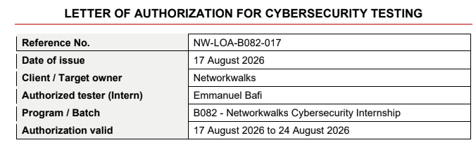
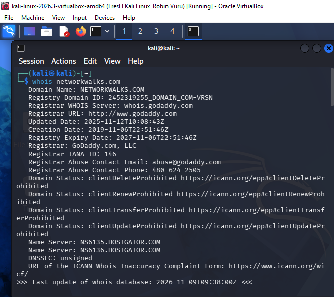
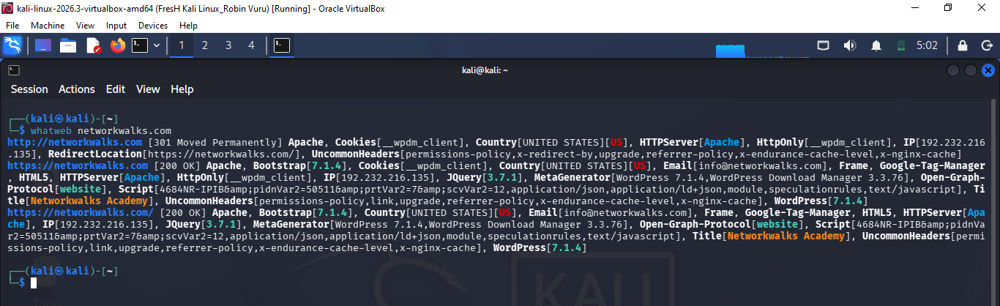
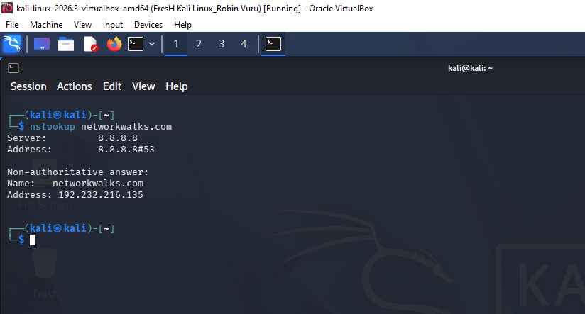
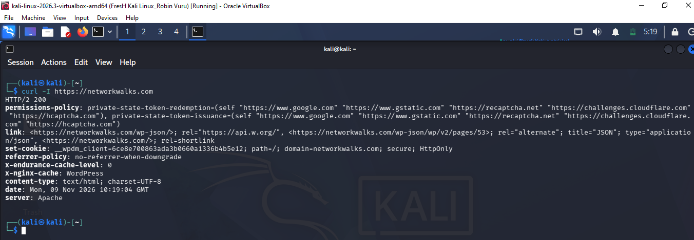

# Networkwalks-RobinVuru-B084-WK2-PM1_PM5-Cybersecurity-Footprinting-Reconnaince-NetworkScanning
# PENETRATION TESTING REPORT
## FOOTPRINTING & NETWORK SCANNING PHASES
### W2-PM-FINAL | CYBERSECURITY | NETWORKWALKS

| Pentester Name (Cybersecurity Professional) | Robin Vuru |
| --- | --- |
| Program/Batch | B084 - Networkwalks |
| Date | 12 November 2026 |
| Modules completed | W2-PM1 (Footprinting with Multiple Kali Tools) W2-PM3 (Maltego based Footprinting) W2-PM4 (theHarvester based Footprinting) W2-PM5 (Zenmap based Network Scanning) |
| Client/Target | 1. Networkwalks (secured written permission already) 2. My own local LAN Network |
| Permission secured from client? | Yes |
| Phases covered | Phase 1: Reconnaissance & Footprinting Phase 2: Scanning & Network Discovery Phase 3-5: In Progress |

---

## 1. Liability Disclaimer

I have performed these activities only on the systems & devices where I had secured written permission or the devices/systems that I own myself. All these materials are for education and research purpose only. Do not use anything from here to break the law. The instructor, the authors and Networkwalks are not responsible for what you do with this knowledge. Every action you take is your own responsibility. Misuse can lead to criminal charges, heavy fines, loss of your job and a permanent record. In most countries unauthorised access is a crime even when nothing is damaged.

This was NOT pentesting. No exploitation was performed. You must get proper authorization before scanning or testing any system you don't own. No authorization = no testing.

## 2. Introduction

This report covers footprinting the networkwalks.com domain using multiple Kali Linux tools (W2-PM1), visual footprinting with Maltego (W2-PM3), OSINT harvesting with theHarvester (W2-PM4), and scanning my own local network with Zenmap (W2-PM5).

The first three modules cover the footprinting phase and the last module covers the scanning phase, so together they show how an attacker moves from gathering public information to mapping live hosts on a network. It is the Week 2 part of my ongoing internship program at Networkwalks.

All commands were run in Kali Linux (footprinting) and on a Windows PC with Zenmap installed (scanning). Every step below includes what the tool is, what I did, what I learnt, and why the finding matters from a defender's point of view.

## 3. Tools Used

| Tool | Purpose |
| --- | --- |
| Kali Linux & Windows | Operating systems used for reconnaissance activities |
| WHOIS | Find domain registration details (owner, dates, name servers) |
| WhatWeb | Fingerprint web technologies (server, CMS, plugins, IP) |
| Nslookup | Resolve the domain name to its IP address using DNS |
| Curl -I | Read the HTTP response headers of the website |
| Wafw00f | Detect whether a Web Application Firewall protects the site |
| DNSRecon | Enumerate all DNS records (NS, MX, SPF, TXT, SRV) |
| Maltego | Visualize OSINT connections as a graph - domains, IPs, emails, people |
| theHarvester | Search many public sources at once for emails, hosts and subdomains |
| Zenmap (Nmap GUI) | Scan the local subnet to find live hosts, IPs and MAC addresses |
| Windows CMD - ipconfig | Local IP and MAC address identification |

## 4. Activities Performed

### 4.1 Footprinting & Reconnaissance - W2-PM1

**What it is:** Passive reconnaissance using Kali tools to collect public information about a target without attacking it.

**What I did / What I learnt:**
I performed reconnaissance against the networkwalks.com domain using six Kali Linux tools: WHOIS, WhatWeb, Nslookup, Curl, Wafw00f and DNSRecon.

- **WHOIS:** I learnt how to obtain publicly available domain registration information and identify the domain's name servers and hosting infrastructure.
- **WhatWeb:** I learnt how to identify technologies used by the website. It identified WordPress and WP Download Manager, along with other information exposed by the website.
- **Nslookup:** I learnt how to resolve the domain name to its IP address using DNS.
- **Curl -I:** I learnt how to inspect HTTP response headers. This exposed additional information about the web application, including the WordPress REST API endpoint `/wp-json/`.
- **Wafw00f:** I learnt how to determine whether a Web Application Firewall was protecting the website. It identified ModSecurity (SpiderLabs).
- **DNSRecon:** I learnt how to enumerate DNS records - name servers, mail servers, SPF/TXT records, service records and DNS software information.

### 4.2 Footprinting with Maltego - W2-PM3

**What it is:** The same kind of footprinting investigation as PM1, but shown visually as a graph.

**What I did / What I learnt:**
I used Maltego to create entities for the target domain and run transforms to discover related infrastructure - subdomains, IP addresses, DNS records, emails and related entities.

I learnt that Maltego does not collect new types of data on its own - it makes relationships easier to understand. Seeing a domain connected to its IPs, mail servers and other entities in one graph makes it much easier to build a full profile of a target than reading text outputs.

### 4.3 Footprinting with theHarvester - W2-PM4

**What it is:** An OSINT tool that searches many public sources at once for emails, hosts and subdomains related to a domain.

**What I did / What I learnt:**
I used theHarvester against the target domain to search for emails, subdomains and hosts from public sources.

I learnt that theHarvester is only as good as its setup. Without proper setup and API keys, many sources will not return results. Free sources can still reveal useful information, but paid / API-based sources need keys configured in the config file first.

This taught me a defender lesson too: even free OSINT can expose emails and subdomains that attackers can use for phishing and further enumeration.

### 4.4 Network Scanning with Zenmap - W2-PM5

**What it is:** Moving from passive recon to active scanning - discovering which devices are live on a network.

**What I did / What I learnt:**
For this activity, I used Zenmap to perform network discovery on my own local network. I had to identify my local IP address and subnet, discover live hosts, identify their IP and MAC addresses, and generate a network topology.

I first used the Windows `ipconfig` command to identify my local IP address and LAN subnet. I then entered the subnet into Zenmap and selected Ping Scan to identify active hosts.

I learnt how to discover live hosts, identify them by IP and MAC address, and use the Topology view in Zenmap to visualise the network. After completing the scan, I opened the Topology section, enabled the legend and saved the network topology as required.

## 5. Risk Analysis / Impact

Based on the information collected, I identified the following potential risks.

Risk level key: ● Critical ● Medium ● Low

| # | Risk / Finding | Evidence / Observation | Potential Impact | Risk Level |
| --- | --- | --- | --- | --- |
| 1 | Web technology information exposed | WhatWeb identified WordPress and WP Download Manager | Attackers may use exposed technology/version information to identify software requiring further security review | ● Medium |
| 2 | Server IP address identifiable | Nslookup resolved the domain to its IP | Provides information about the network location of the web service | ● Low |
| 3 | HTTP technical information exposed | Curl returned HTTP response headers and exposed `/wp-json/` | May assist technology fingerprinting and further enumeration | ● Low |
| 4 | WAF technology identifiable | Wafw00f identified ModSecurity (SpiderLabs) | Reveals information about the web application's security architecture | ● Low |
| 5 | DNS infrastructure information exposed | DNSRecon identified DNS, mail and service-related records | DNS information can help build a broader infrastructure profile | ● Medium |
| 6 | Emails / subdomains exposed via OSINT | theHarvester / Maltego found public emails, hosts and subdomains | Can be used for phishing, social engineering and further enumeration | ● Medium |
| 7 | Multiple live hosts visible on local network | Zenmap identified live hosts in my lab network | Unknown or unauthorized devices may potentially be present on a network | ● Medium |

The risks above are observations from footprinting and scanning exercises, not confirmed vulnerabilities.

The practical exercises primarily involved information gathering and host discovery. No exploitation or vulnerability validation was performed as part of these modules.

Therefore, the presence of information such as a software version, IP address or DNS record does not by itself mean that the system is vulnerable. Further authorized security testing would be required to confirm any actual vulnerability.

## 6. Recommendations

- **Review publicly exposed technology information:** Regularly review what information about web technologies, CMS and plugins is publicly visible.
- **Keep software updated:** CMS platforms, plugins and other web technologies should be regularly updated and reviewed against current security advisories.
- **Review HTTP headers:** HTTP response headers should be reviewed to determine whether unnecessary technical information is being exposed.
- **Review DNS records regularly:** DNS records should be checked periodically to ensure only required information and services are publicly exposed.
- **Properly configure and monitor the WAF:** Keep the WAF (ModSecurity) enabled and tuned, since it already blocks naive attacks.
- **Reduce OSINT exposure:** Review what emails, subdomains and employee information are publicly available and remove what is not needed.
- **Perform regular internal network discovery:** Organizations should periodically scan their own networks to identify active devices.
- **Investigate unknown devices:** Any unexpected device discovered during network scanning should be investigated and verified.
- **Maintain network documentation:** Network topology and device information should be documented and updated regularly.
- **Perform security testing with authorization:** Reconnaissance and scanning should only be performed against systems and networks where appropriate authorization has been provided.

## 7. Conclusion

During Week 2 of my Cybersecurity & Ethical Hacking internship, I completed practical activities covering footprinting, reconnaissance and network scanning.

In PM1, I used six Kali Linux tools to collect information about the target domain. I learned how WHOIS can provide domain information, WhatWeb can identify web technologies, Nslookup can resolve domain names, Curl can inspect HTTP headers, Wafw00f can identify a WAF, and DNSRecon can provide additional DNS information.

In PM3, I learned how Maltego visualises the same investigation as a graph, making relationships easier to understand.

In PM4, I learned how theHarvester searches many public sources at once, and that without API keys many sources will not return results.

In PM5, I used Zenmap to identify my local network configuration and discover active hosts. I also collected IP and MAC address information and created a network topology.

The exercises showed me that information gathering is an important part of cybersecurity. Even before attempting to exploit a system, a security professional can learn a significant amount about an environment by carefully analyzing publicly available information and network responses.

I also learned that technical findings should be documented clearly. A good cybersecurity report should explain what was performed, what was discovered, what the observation means, what risk it may create, and what can be done to reduce that risk.

Finally, I learned that reconnaissance and scanning must always be performed within an authorized scope. These activities were completed as part of the assigned educational cybersecurity lab.

## 8. Evidences Collected

  
   
  <em>Capture 0: Authorisation</em>

  
   
  <em>Capture 1: W2PM1|$ who is networkworks.com</em>

  
   
  <em>Capture 3: W2PM1|$ whatweb networkworks.com</em>

  
   
  <em>Capture 5: W2PM1|$ nslookup networkworks.com</em>

  
   
  <em>Capture 6: W2PM1|$ curl -I https://networkworks.com</em>

-End-

**Author**
Robin Vuru
Cybersecurity Professional B084 - Networkwalks
GitHub: https://github.com/Trobs553

**Project Information**
Program Name: Cybersecurity program at Networkwalks | Week: 02 | Repository: GitHub
